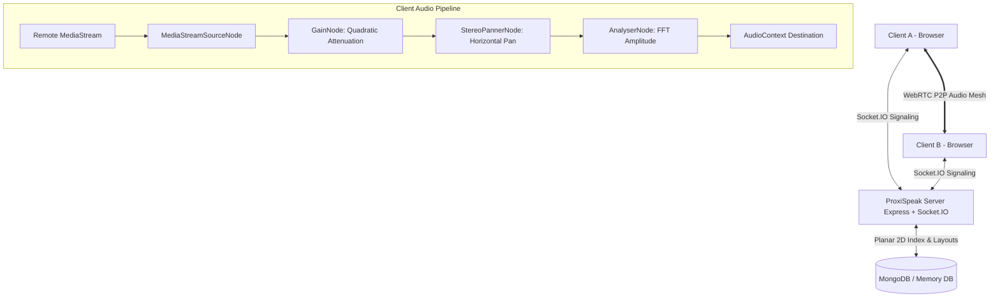
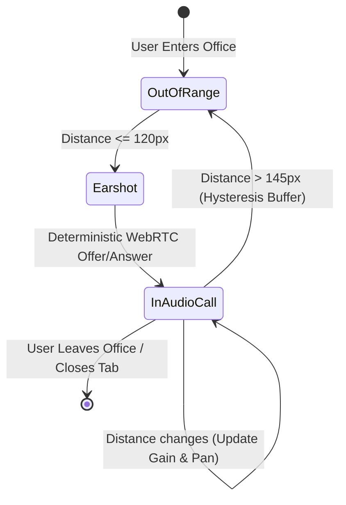

# ProxiSpeak: Real-Time Geospatial Proximity Audio Ecosystem

**ProxiSpeak** is a high-performance, real-time virtual office platform that enables proximity-based voice communication and spatial audio for remote teams. Colleagues navigate a 2D virtual workspace where voice audio volume attenuates naturally based on physical distance, complete with stereo panning and sound-blocking acoustic partitions.

---

## 1. Project Overview & Problem Statement

### The Problem
Traditional video conferencing tools (Zoom, Google Meet, Microsoft Teams) trap participants in static grid layouts with an "all-or-nothing" audio dynamic: only one person can effectively speak at a time, making casual hallway chats, spontaneous desk-side questions, and breakout discussions unnatural.

### The Solution
ProxiSpeak models human auditory physics inside a real-time 2D overhead virtual office:
- **Natural Spatial Proximity**: Audio fades in as you approach colleagues and drops to zero when leaving hearing range.
- **Stereo Panning**: Colleague voices are spatialized left or right according to their horizontal position on your screen.
- **Acoustic Obstacles**: Glass partitions and soundproof conference rooms attenuate or isolate audio.
- **WebRTC Mesh P2P**: Direct, low-latency audio transmission directly between client browsers.
- **Persistent Office Environments**: Layouts, zones, and planar geospatial snapshots stored in MongoDB.

---

## 2. Main Features

- 🏢 **Interactive 2D Canvas Office**: Custom rendering engine using HTML5 Canvas with smooth 60 FPS interpolation, WASD/arrow key navigation, and wall/furniture collision sliding.
- 🎙️ **Peer-to-Peer WebRTC Audio**: Native browser WebRTC with deterministic offer/answer negotiation, eliminating collision glare.
- 🎧 **Web Audio API Spatial Mixer**: Quadratic volume attenuation ($gain = (1 - distance/radius)^2$), horizontal stereo panning, and smooth exponential ramp transitions (`setTargetAtTime`).
- 🧱 **Sound-Blocking Acoustic Partitions**: Raycast line-of-sight intersection against office walls and furniture to dampen or mute blocked audio.
- 📡 **Socket.IO Real-Time Sync**: Low-latency movement synchronization throttled at 20Hz, presence state tracking, and WebRTC signaling exchange.
- 🗺️ **MongoDB Planar Geospatial Queries**: Native 2D planar indexing (`location: '2d'`) supporting Euclidean Cartesian `$near` and `$geoWithin` queries.
- 📊 **Participant Roster & Audio Visualizer**: Live amplitude meter bars, earshot range indicators, and real-time distance calculations.
- 🎛️ **Full Session Controls**: Instant mic mute/unmute, speaker deafen toggle, adjustable hearing radius (60px–240px), and clean departure teardown.

---

## 3. Technology Stack

### Frontend
- **Framework**: React 19 + Vite
- **Rendering**: HTML5 Canvas 2D API (retina pixel ratio support, `requestAnimationFrame`)
- **Styling**: Vanilla CSS3 (Sleek cyber-slate dark mode, frosted glassmorphism, glowing HUD)
- **Audio Engine**: Web Audio API (`AudioContext`, `MediaStreamAudioSourceNode`, `GainNode`, `StereoPannerNode`, `AnalyserNode`)
- **Real-Time Client**: Socket.IO Client 4.8
- **Icons**: Lucide React
- **Testing**: Vitest & React Testing Library with JSDOM

### Backend
- **Runtime**: Node.js (ES Modules)
- **Web Framework**: Express.js 4.21
- **Real-Time Engine**: Socket.IO 4.8 with office room isolation
- **Database & ODM**: MongoDB & Mongoose 8.9 (with automatic in-memory fallback for offline development)
- **Geospatial Model**: Planar 2D Euclidean coordinate indexing (`[x, y]`)
- **Testing**: Node.js built-in test runner (`node:test`, `node:assert`) & Supertest

---

## 4. Architecture Explanation

### System Overview Diagram



### Proximity State Transition Diagram



---

## 5. Directory Structure

```
ProxiSpeak/
├── client/
│   ├── public/
│   ├── src/
│   │   ├── components/
│   │   │   ├── AudioStatusToast.jsx    # Microphone alerts & banners
│   │   │   ├── CanvasOffice.jsx        # 60 FPS HTML5 Canvas office view
│   │   │   ├── ControlDock.jsx         # Bottom audio controls dock
│   │   │   ├── HeaderBar.jsx           # Top header & room status
│   │   │   ├── LobbyModal.jsx          # User onboarding & office picker
│   │   │   └── ParticipantRoster.jsx   # Live colleague roster & audio bars
│   │   ├── services/
│   │   │   ├── apiService.js           # REST API client
│   │   │   ├── socketService.js        # Socket.IO client & signaling bridge
│   │   │   ├── spatialAudioMixer.js    # Web Audio API spatial engine
│   │   │   └── webRtcService.js        # WebRTC P2P connection manager
│   │   ├── styles/
│   │   │   └── index.css               # Modern dark-mode styling
│   │   ├── test/
│   │   │   ├── components.test.jsx     # RTL component unit tests
│   │   │   ├── geometry.test.js        # Client geometry & attenuation tests
│   │   │   └── setup.js                # Vitest test setup
│   │   ├── utils/
│   │   │   └── geometry.js             # Client geometry & raycast math
│   │   ├── App.jsx                     # Application coordinator
│   │   └── main.jsx                    # React mount entry
│   ├── index.html
│   ├── package.json
│   └── vite.config.js
├── server/
│   ├── src/
│   │   ├── config/
│   │   │   ├── constants.js            # Office layouts, events, limits
│   │   │   ├── db.js                   # Mongoose connection with memory fallback
│   │   │   └── rtcConfig.js            # STUN/TURN ICE server configuration
│   │   ├── middleware/
│   │   │   ├── errorHandler.js         # Centralized error handler
│   │   │   └── validation.js           # Coordinate & payload validator
│   │   ├── models/
│   │   │   ├── Office.js               # Office layouts & obstacle schema
│   │   │   ├── PositionSnapshot.js     # Planar 2D geospatial index schema
│   │   │   └── User.js                 # Session & profile schema
│   │   ├── routes/
│   │   │   ├── officeRoutes.js         # REST endpoints for offices & $near
│   │   │   └── userRoutes.js           # User session generation
│   │   ├── services/
│   │   │   ├── collisionService.js     # Boundary clamping & wall sliding
│   │   │   ├── geospatialService.js    # MongoDB planar queries ($near, $box)
│   │   │   └── proximityEngine.js      # In-memory real-time proximity engine
│   │   ├── sockets/
│   │   │   └── socketManager.js        # Socket.IO room manager & signaling
│   │   ├── utils/
│   │   │   └── geometry.js             # Distance, attenuation, line-rect math
│   │   ├── app.js                      # Express app factory
│   │   └── server.js                   # HTTP & Socket.IO server startup
│   ├── tests/
│   │   ├── api.test.js                 # REST & Geospatial integration tests
│   │   ├── collision.test.js           # Wall sliding & boundary tests
│   │   ├── geometry.test.js            # Distance, gain, pan, raycast tests
│   │   └── proximity.test.js           # Hysteresis & pair tracking tests
│   └── package.json
├── .env.example
├── .gitignore
├── package.json                        # Root monorepo orchestration
└── README.md
```

---

## 6. Mathematical Formulas & Physics Model

### 1. Euclidean Distance
For user $A(x_1, y_1)$ and user $B(x_2, y_2)$:
$$\text{distance} = \sqrt{(x_2 - x_1)^2 + (y_2 - y_1)^2}$$

### 2. Quadratic Audio Gain Attenuation
Audio follows the inverse square law of acoustic pressure, normalized to the hearing radius ($R = 120\text{px}$):
$$\text{normalizedDistance} = \min\left(1, \max\left(0, \frac{\text{distance}}{R}\right)\right)$$
$$\text{gain} = (1 - \text{normalizedDistance})^2$$
When $\text{distance} \ge R$, $\text{gain} = 0$.

### 3. Stereo Panning
Horizontal sound localization maps relative horizontal offset to $[-1, 1]$:
$$\text{pan} = \text{clamp}\left(\frac{x_{\text{remote}} - x_{\text{local}}}{R}, -1, 1\right)$$
- $-1$: Hard Left
- $0$: Center
- $+1$: Hard Right

### 4. Hysteresis Buffer
To eliminate boundary oscillation (rapid connect/disconnect when hovering at 120px):
- **Entry Distance**: $\le 120\text{px}$
- **Exit Distance**: $> 145\text{px}$ ($120\text{px} + 25\text{px}\text{ grace buffer}$)

### 5. Sound-Blocking Ray Intersection
Before rendering audio at full gain, a ray cast between $A$ and $B$ checks intersection with any acoustic partitions:
$$\text{isObstructed} = \text{lineIntersectsRect}(\text{pos}_A, \text{pos}_B, \text{rect})$$
If obstructed, volume gain is attenuated by $85\%$ ($\text{gain} \times 0.15$) to simulate heavy acoustic dampening.

---

## 7. MongoDB Planar Geospatial Implementation

### Planar Coordinate System vs. Spherical
Unlike geographic mapping applications where coordinates represent spherical latitude/longitude, a virtual office exists on a flat Cartesian pixel grid.

Using spherical indexing (`2dsphere`) on pixels causes geographic distortions and errors because pixels exceed $[-180, 180]$. ProxiSpeak uses MongoDB's legacy coordinate pairs with a **2d planar index**:
```javascript
// server/src/models/PositionSnapshot.js
const positionSnapshotSchema = new mongoose.Schema({
  userId: { type: String, required: true },
  officeId: { type: String, required: true },
  location: { type: [Number], required: true }, // [x, y] in pixels
  lastUpdated: { type: Date, default: Date.now }
});

// Configure planar bounds from -1000 to 10,000 pixels
positionSnapshotSchema.index({ location: '2d' }, { min: -1000, max: 10000 });
```

### In-Memory Engine vs. MongoDB Database
| Metric | In-Memory Engine (`ProximityEngine`) | MongoDB Geospatial (`GeospatialService`) |
| :--- | :--- | :--- |
| **Frequency** | 20–60 updates / second | Throttled snapshots (1 update / 10 sec) |
| **Storage** | Server RAM (`Map`, `Set`) | Persistent MongoDB disk collection |
| **Latency** | $< 0.5\text{ ms}$ | $5 - 20\text{ ms}$ |
| **Purpose** | Instant WebRTC trigger & spatial panning | Historical presence, snapshots & spatial queries |

---

## 8. Socket.IO Event Contract

| Event Name | Direction | Payload | Description |
| :--- | :--- | :--- | :--- |
| `office:join` | Client $\to$ Server | `{ officeId, userId, displayName, avatarColor, x, y }` | Joins office room and initializes user state |
| `office:state` | Server $\to$ Client | `{ office, currentUser, users, iceServers, hearingRadius }` | Initial synchronization payload |
| `user:move` | Client $\to$ Server | `{ officeId, x, y }` | Client sends movement update (throttled at 20Hz) |
| `user:moved` | Server $\to$ Client | `{ userId, x, y }` | Broadcasts remote colleague's new coordinates |
| `proximity:entered` | Server $\to$ Client | `{ peerId, distance, isObstructed, shouldInitiateOffer }` | Triggers WebRTC offer negotiation |
| `proximity:left` | Server $\to$ Client | `{ peerId, distance }` | Tears down peer audio connection |
| `audio:state` | Client $\to$ Server | `{ officeId, micMuted }` | Notifies server of microphone mute change |
| `audio:state-changed` | Server $\to$ Client | `{ userId, micMuted }` | Broadcasts mute state to all colleagues |
| `rtc:offer` | Bidirectional | `{ targetPeerId / senderPeerId, sdp }` | Relays WebRTC SDP offer |
| `rtc:answer` | Bidirectional | `{ targetPeerId / senderPeerId, sdp }` | Relays WebRTC SDP answer |
| `rtc:ice-candidate`| Bidirectional | `{ targetPeerId / senderPeerId, candidate }` | Relays ICE candidate for NAT traversal |
| `office:leave` | Client $\to$ Server | None | Cleans up user state on departure |

---

## 9. REST API Documentation

### Offices
- `GET /api/offices`: Returns list of all virtual offices (auto-seeds default headquarters if empty).
- `POST /api/offices`: Creates a new custom office layout.
- `GET /api/offices/:id`: Fetches office metadata by ID or slug code.
- `GET /api/offices/:id/layout`: Retrieves full layout containing zones, walls, and furniture.
- `PUT /api/offices/:id/layout`: Updates walls and furniture obstacles.
- `GET /api/offices/:id/nearby?x=200&y=200&radius=120`: Executes MongoDB planar `$near` query.
- `POST /api/offices/:id/snapshot`: Records user planar coordinates snapshot.

### User Sessions
- `POST /api/users/session`: Generates a server-controlled unique session identifier (`pxs_...`) and profile.

### Health
- `GET /health`: Diagnostic health check returning service status and timestamp.

---

## 10. Quickstart & Installation

### Prerequisites
- **Node.js**: v18.0.0 or higher (v22.x recommended)
- **npm**: v9.0.0 or higher
- **MongoDB**: (Optional) MongoDB local or MongoDB Atlas URI. If no MongoDB server is detected, ProxiSpeak automatically boots an in-memory database!

### Setup
```bash
# Clone the repository
cd ProxiSpeak

# Install server dependencies
cd server
npm install

# Install client dependencies
cd ../client
npm install
```

### Environment Configuration
Copy `.env.example` to `server/.env`:
```env
PORT=5000
NODE_ENV=development
CLIENT_ORIGIN=http://localhost:5173
MONGODB_URI=mongodb://127.0.0.1:27017/proxispeak
USE_MEMORY_DB=false
RTC_STUN_SERVERS=stun:stun.l.google.com:19302,stun:stun1.l.google.com:19302
PROXIMITY_HEARING_RADIUS=120
PROXIMITY_EXIT_GRACE=25
```

### Starting the Application

#### Option A: Run concurrently from root
```bash
# From project root:
npm run dev:server    # Starts backend on http://localhost:5000
npm run dev:client    # Starts frontend on http://localhost:5173
```

#### Option B: Run in separate terminals
**Terminal 1 (Backend Server):**
```bash
cd server
npm start
```

**Terminal 2 (Frontend Client):**
```bash
cd client
npm run dev
```

Navigate to `http://localhost:5173` in your browser.

---

## 11. Multi-Browser Testing Guide (Real WebRTC Audio)

To test spatial proximity audio with two users:

1. **Window 1 (User 1)**:
   - Open Chrome at `http://localhost:5173/`.
   - Enter name: `Alice` (Pick Indigo theme).
   - Click **Enter Office**.
   - Grant microphone permissions when prompted.
2. **Window 2 (User 2 - Incognito or Secondary Browser)**:
   - Open Incognito / Edge at `http://localhost:5173/`.
   - Enter name: `Bob` (Pick Emerald theme).
   - Click **Enter Office**.
   - Grant microphone permissions when prompted.
3. **Verify Proximity Audio**:
   - Move Alice towards Bob using `W`, `A`, `S`, `D`.
   - When within **120px**, you will see:
     - A cyan dashed link ray connecting the avatars.
     - The Participant Roster displays `In Earshot` with live pixel distance.
     - WebRTC audio connects automatically!
   - Speak into the microphone:
     - The green soundwave pulse rings will animate around the speaker's avatar.
     - Voice volume increases as you move closer, and attenuates as you walk away.
     - Moving to the right shifts audio to the right stereo channel; moving to the left shifts audio left.
   - Walk behind an **Acoustic Glass Partition**: audio will immediately muffle.
   - Click **Mic Muted** to test mute controls.

---

## 12. Automated Test Results

### Server Tests (15 Passed, 0 Failed)
```
✓ CollisionService & Boundary Clamping
  - clampToBounds clamps position inside width and height
  - resolveMovement enables sliding along walls when one axis is free
✓ Geometry & Spatial Audio Utilities
  - calculateDistance calculates exact Euclidean distance
  - calculatePan maps relative horizontal position correctly
  - calculateGain follows quadratic attenuation curve and drops to 0 at/beyond boundary
  - lineSegmentsIntersect detects crossing segments
  - lineIntersectsRect detects ray obstruction through sound blocking obstacles
  - circleCollidesWithRect detects avatar circle collision with walls
✓ ProximityEngine Behavior & Hysteresis
  - detects proximity entry within hearingRadius and designates deterministic initiator
  - applies hysteresis grace period to prevent jitter at boundary
  - cleans up pairs and notifies active peers when a user departs
✓ REST API & Geospatial Integration Tests
  - GET /health returns healthy status
  - GET /api/offices auto-seeds default office if empty
  - POST /api/users/session creates unique session identity
  - Planar Geospatial Query: POST /api/offices/:id/snapshot & GET /nearby ($near query)
```

### Client Tests (8 Passed, 0 Failed)
```
✓ src/test/geometry.test.js
  - calculates Euclidean distance accurately
  - calculates horizontal stereo pan correctly
  - calculates quadratic gain attenuation curve and zero beyond hearing radius
  - detects ray intersection through sound-blocking partitions
  - detects circle vs rectangle collision
✓ src/test/components.test.jsx
  - HeaderBar renders brand title and online user count
  - ControlDock renders mic mute, deafen, and leave buttons
  - LobbyModal renders display name input and enter office button
```

---

## 13. Security Considerations

- **Server-Managed Session Identity**: Client display names are not trusted as authentication; cryptographically secure session IDs (`pxs_...`) are issued and verified by the server.
- **Room Isolation**: Socket.IO strictly binds signaling events to specific `office:${officeId}` rooms, preventing cross-tenant eavesdropping.
- **Payload Validation**: Coordinate updates are validated to prevent `NaN`, `Infinity`, or arbitrary buffer injection.
- **No Audio Recording**: ProxiSpeak transmits peer-to-peer WebRTC streams directly without storing or recording audio on the server.
- **TURN Credential Protection**: TURN credentials are kept in server environment variables and never bundled into client source code.

---

## 14. License

MIT License. Built for modern high-performance spatial collaboration.

